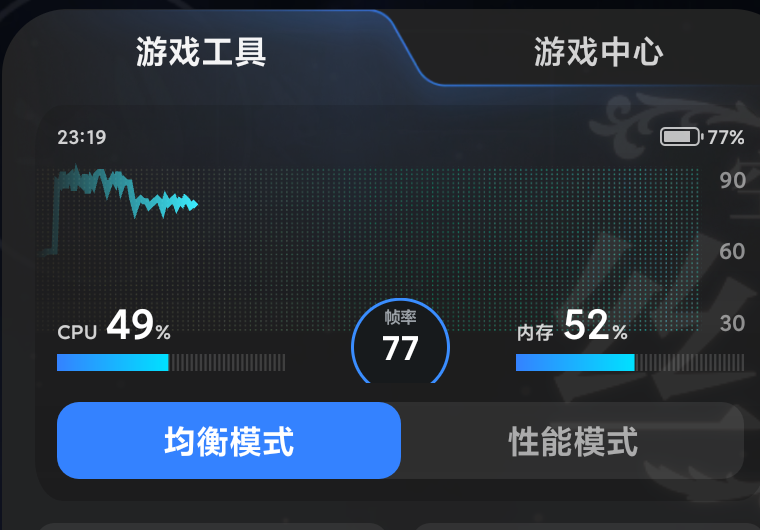
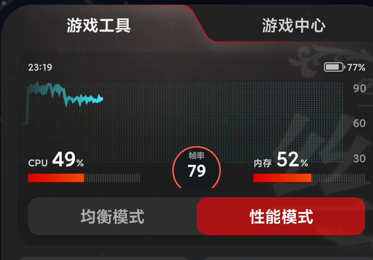

# 给小米澎湃 OS4 的 Game Turbo 性能面板恢复帧率曲线

---

## 效果

| | 改造前 | 改造后 |
|---|---|---|
| 帧率曲线 | 被隐藏，只剩圆形表盘和大号数字 | 顶部显示约 60dp 高的青色曲线 |
| 圆形表盘 | 显示 | 改为自绘 36dp 圆形细环表盘，只保留顶部“帧率”标签和中间数字 |
| FPS 数字 | 居中大号数字 | 保留在圆形表盘中心，放在 CPU / 内存中间；数字放大到 12sp，示例 `77` / `79` |
| 样式 | — | 深色圆底 + 3px 细环，数字白色；已去掉底部 `FPS` 字样 |
| 模式配色 | — | 均衡模式蓝色 `#3A8DFF`，性能模式红色 `#FF5A4A`，切换后自动更新 |
| 曲线数据 | — | 由系统 `FrameRateDataService` 按约 1 秒 1 点采样；模块不再常驻采样，也不额外缓存，面板重开时显示服务已保留的历史 |

实际效果（仅保留 Game Turbo 性能面板区域）：

均衡模式（蓝色）：



性能模式（红色）：



---

## 适用环境

当前只在下面这套环境完整验证：

| 项目 | 值 |
|---|---|
| 机型 | Xiaomi `M2007J17C` / `gauguinpro` |
| 系统 | HyperOS `4.0.5.0.XPCCNXM` |
| Android | 17 / SDK 37 |
| Build | `CP2A.260605.016` |
| Game Turbo 宿主 | `com.miui.securitycenter` `13.6.5-261003.0.1` |
| Root | Magisk 31.1 + Zygisk |
| Hook 框架 | LSPosed 2.2.1 |
| 模块 | `com.xiaomi.fpsgraph`，versionName `1.01`（构建标记 v1.02，md5 `54a5f33f50b8c232d4d28f2887fa7f2d`） |

其它机型或 HyperOS 版本可以复用思路，但布局资源 ID 和混淆后的类名可能不同，**不保证直接可用**。不要为了适配其它版本去替换系统 APK。

---

## 从源码重建

依赖：

- Windows + PowerShell
- Java 8
- smali / dexlib2 / guava / antlr / jcommander / util
- Android SDK Build-Tools（`zipalign`、`apksigner`）
- ADB（仅部署调试时需要）

步骤：

1. 打开 `rebuild.ps1`，按本机路径修改顶部变量：
   - `$Java`
   - `$SmaliRoot`
   - `$BuildTools`
   - `$Adb`
2. 执行：

   ```powershell
   .\rebuild.ps1
   ```

脚本会把 `src/*.smali` 汇编成 `classes.dex`，替换进 `unsigned.apk`，再对齐、签名，输出 `fpsgraph.apk`。构建产物不提交进仓库。

> `debug.keystore` 只用于调试签名；长期维护建议换成自己的 key，并固定同一个 key 更新。

---

## 项目结构

| 路径 | 用途 |
|---|---|
| `src/Main.smali` | 模块入口，注册 LSPosed Hook |
| `src/PanelHook.smali` | 恢复曲线、自绘圆形表盘、调整 FPS 读数位置 |
| `unsigned.apk` | 含 manifest、资源、assets 的基础 APK |
| `AndroidManifest.xml` | LSPosed 模块清单 |
| `xposed_init.txt` | 模块入口类 |
| `rebuild.ps1` | 汇编、替换 dex、对齐、签名 |
| `debug.keystore` | 调试签名，非生产 key |
| `docs/DEVELOPMENT.md` | 更完整的开发与调试笔记 |
| `LICENSE` | MIT |

---

## 开发者文档

更深入的内容在 [`docs/DEVELOPMENT.md`](docs/DEVELOPMENT.md)：完整资源 ID、`PerformancePanelViewNew` / `FrameRateView` 结构、Smali 细节、构建命令、日志和实测记录。

---

## License

[MIT](LICENSE)

本项目与小米 / 小米澎湃 OS 官方无关；Xiaomi、HyperOS、Game Turbo 是其各自权利人的商标。使用本改造造成的设备问题由使用者自行承担。
